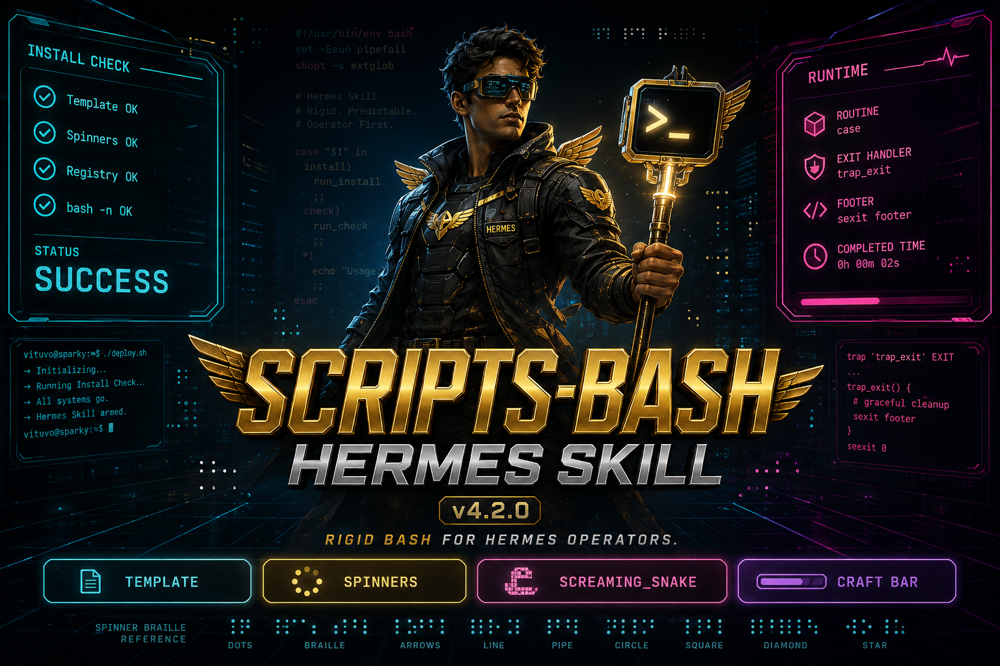

# scripts-bash

[](https://github.com/NousResearch/hermes-agent)
[](#install)
[](LICENSE)

> **MCP gives Hermes tools. Skills give Hermes judgment. `scripts-bash` gives Hermes a standard for the bash that runs your stack.**

**Current skill version: 4.3.0**



## Why this exists

Hermes already orchestrates terminal, files, profiles, cron, and secrets. What it still needs for serious ops work is a **rigid house style** so every installer looks the same, fails cleanly, and reads like a product.

`scripts-bash` teaches Hermes (and you) to ship bash with:

| Pillar | What you get |
|--------|----------------|
| **Locked skeleton** | Header, colors, spinners, `ROUTINE` + `case`, `sexit` footer |
| **Stable names** | SCREAMING_SNAKE globals with a living registry |
| **Authoring recipe** | tutorial plus the clone-an-installer recipe |
| **Craft bar** | Quote discipline, `[[ ]]`, dryrun, idempotent install, no secret dumps |
| **Lean package** | Skill law only - your host installers stay in your workspace |

Complements Hermes. Does not replace it. Does not claim to be a general "learn bash" course.

## Install (Hermes drop-in)

```bash
git clone https://github.com/Unix-Dev-Ops/scripts-bash.git
mkdir -p ~/.hermes/skills/software-development
cp -a scripts-bash/skills/software-development/scripts-bash \
  ~/.hermes/skills/software-development/
```

In a Hermes session:

```text
/reload-skills
/skill scripts-bash
```

**Don't mirror it into a profile.** One pointer is the install. A copy under
`~/.hermes/profiles/<profile>/skills/` is a second source of truth that silently stops
tracking the repo the day either one gets edited.

Standing rule (recommended in SOUL / AGENTS):

```text
For long-lived bash installer/manager scripts: load skill scripts-bash first.
Products go under profile workspace/installers/ or workspace/scripts/.
```

## Quickstart

```text
Load scripts-bash, then copy templates/template-base.sh to
workspace/installers/<tool>/installer-<tool>.sh and build me an installer
for <tool>. It installs under ~/.hermes-programs/<tool>/, serves on one port of
my choosing, uses no sudo, and exposes install / update / start / stop / status /
uninstall.
```

Then verify before you run anything:

```bash
bash -n workspace/installers/<tool>/installer-<tool>.sh
shellcheck -x workspace/installers/<tool>/installer-<tool>.sh   # CI runs both
bash workspace/installers/<tool>/installer-<tool>.sh status
```

Full walkthrough: [`skills/software-development/scripts-bash/references/authoring.md`](skills/software-development/scripts-bash/references/authoring.md)

## Package layout

```text
skills/software-development/scripts-bash/
  SKILL.md
  templates/template-base.sh                    # ONLY executable skeleton
  references/screaming-snake-case-variables.md
  references/authoring.md
  README.md
```

**Not in this repo:** private production installers, host design briefs, API keys, duplicate templates.

## What "good" looks like

- Author / Date / Ver / Name / Define header (column-aligned)
- Braille spinners + clean Ctrl+C (`SPINNER_PID` + trap)
- Green labels, cyan body, bright-red errors - cinematic `sleep 0.05` pacing
- `cmd_exit=$?` **before** `stop_spinner`
- `show_usage` exits 0 **without** the Completed footer; success paths end in `sexit`
- Prefer explicit failure checks on large installers (house style); do not blind-apply `set -e`

## Contributing

PRs welcome. Review comes from the maintainer listed in [CODEOWNERS](.github/CODEOWNERS);
nothing enforces it mechanically, so treat it as a human convention. CI runs `bash -n`
and `shellcheck` against the template on every push and pull request, so a change that
breaks the skeleton is caught there, not by hand.

The four rules that keep this repo a skill and not a script dump:

- **Scope** - skill law, template, registry, authoring docs. No host-specific production
  installers, no secrets, no personal machine paths that a change would depend on.
- **One concern per change** - "fix the spinner colon rule", not "rewrite everything".
- **Style is not optional** - match `SKILL.md` and `templates/template-base.sh`; there is
  no second banner system.
- **Registry** - append to `screaming-snake-case-variables.md`. Never rename an existing
  entry without a migration note and maintainer sign-off.

Commits follow Conventional Commits (`feat:` `fix:` `docs:` `refactor:` `chore:`).
`main` is cut by the maintainer, so everything on it is releasable as-is.

## Security


See [SECURITY.md](SECURITY.md) to report a vulnerability. It also lists the
bash failure modes this skill treats as security-relevant.

## Related

| Project | Role |
|---------|------|
| [Hermes Agent](https://github.com/NousResearch/hermes-agent) | The agent this skill serves |
| [Hermes docs](https://hermes-agent.nousresearch.com/docs) | Official documentation |

## Author

**Vituvo** ([@Unix-Dev-Ops](https://github.com/Unix-Dev-Ops))

For Hermes operators who manage Docker, local inference, and agent infrastructure.

## License

[MIT](LICENSE) - Copyright (c) 2026 Vituvo
